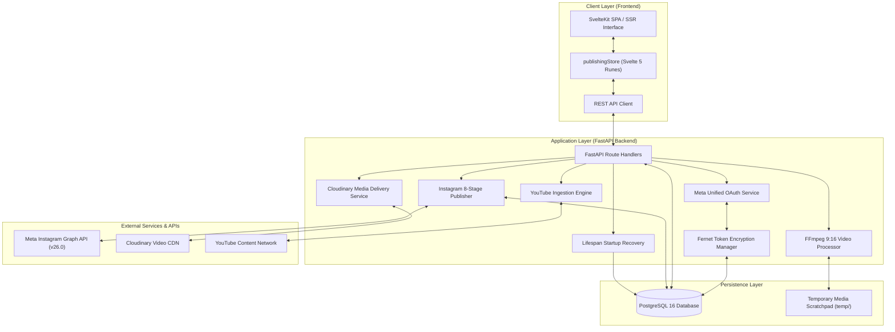
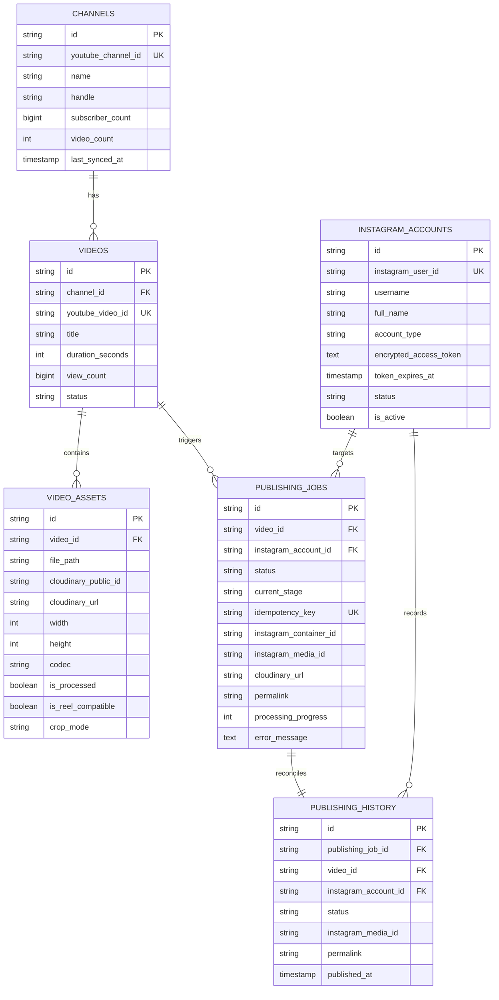

# Adoraxe System Architecture & Design

This document details the architectural principles, component responsibilities, data flow, state machines, and security mechanisms of the **Adoraxe YouTube-to-Instagram Reel Automation Portal**.

---

## 1. High-Level System Architecture

Adoraxe is structured as a decoupled, multi-tier system with an asynchronous pipeline designed for high resilience, idempotent execution, and non-blocking background operations.



---

## 2. Component Responsibilities

### 2.1 Frontend Architecture (`frontend/`)
The frontend is built with **SvelteKit** and **TypeScript**, using **Tailwind CSS** and Svelte 5 runes (`$state`, `$derived`, `$props`).

* **Route Structure**:
  * `/` (`routes/+page.svelte`): Master Dashboard with real-time stat cards, pipeline status, quick-ingest URL bar, and recent publishing activity feed.
  * `/channels` (`routes/channels/+page.svelte`): YouTube channel ingestion, subscriber stats, and sync management.
  * `/library` (`routes/library/+page.svelte`): Video catalog, filter chips (All, Processed, Ready), batch selection, and detailed video inspector (`/library/[id]`).
  * `/instagram` (`routes/instagram/+page.svelte`): Instagram connection details dashboard, token health diagnostics, assigned permissions list, and Meta Unified Login launcher.
  * `/queue` (`routes/queue/+page.svelte`): Publishing queue, 9:16 vertical video player preview, crop-mode aspect ratio filter badges, target account switcher, remove-from-queue modal, and caption composer.
  * `/history` (`routes/history/+page.svelte`): Publishing audit log, live Instagram permalink links (`Open Reel ↗`), error diagnostics, and manual reconciliation triggers.
  * `/settings` (`routes/settings/+page.svelte`): System telemetry, environment configuration check, and demo-mode status switch.
* **Global Reactive State (`src/lib/stores/publishing.svelte.ts`)**:
  * Employs Svelte 5 reactive runes to manage active publishing jobs across the application lifecycle.
  * Survives browser tab navigation, view changes, and page reloads by checking `GET /api/v1/publishing/active` upon mount.
  * Preserves draft captions, active job progress, and stage explanations.

### 2.2 Backend Architecture (`backend/app/`)
The backend is an asynchronous **FastAPI** service adhering to clean layered architecture:

* **API Layer (`app/api/routes/`)**:
  * Exposes RESTful endpoints for channels, video processing, Instagram OAuth, publishing, and system telemetry.
  * Validates all incoming payloads using Pydantic v2 schemas (`app/schemas/schemas.py`).
  * Integrates FastAPI `BackgroundTasks` for non-blocking video transcoding and publishing execution.
* **Core & Configuration (`app/core/config.py`)**:
  * Utilizes `pydantic-settings` to load and validate variables from the root `.env` file.
  * Enforces case-insensitivity, strong typing, and helper properties (e.g., `effective_app_id`, `cloudinary_configured`).
  * Never logs or exposes plain-text secrets or access tokens.
* **Startup Recovery (`app/main.py`)**:
  * Employs the modern FastAPI `lifespan` handler.
  * During startup, scans the database for interrupted in-flight publishing jobs (`QUEUED`, `CONTAINER_CREATING`, `CONTAINER_PROCESSING`, `READY_TO_PUBLISH`, `PUBLISH_REQUESTED`).
  * Transitions stale interrupted jobs to `RECONCILIATION_REQUIRED` or `OUTCOME_UNKNOWN` to ensure the system is never left in an unrecoverable frozen state.

### 2.3 Service Layer (`app/services/`)

#### 1. Ingestion Engine (`app/services/youtube/`)
* Implements the **Provider Pattern** via abstract base class `YouTubeProvider`:
  * `DemoProvider`: Provides verified mock metadata for testing and offline development.
  * `HttpProvider`: Native non-browser HTTP scraper for public YouTube channel metadata.
  * `YtDlpProvider`: Optional media retrieval for creator-owned content.

#### 2. Video Processing Engine (`app/services/video/`)
* Wraps **FFmpeg 9.0.2** and **FFprobe** to transcode videos into strict Instagram Reel requirements:
  * **Aspect Ratio**: 9:16 vertical framing (1080×1920).
  * **Conversion Modes**:
    * `Crop (Center)`: Zooms and crops horizontally to fill 9:16 without distortion.
    * `Pad (Bars)`: Maintains original aspect ratio with top/bottom letterboxing.
    * `Blur Fill`: Centers the original video over a scaled, blurred background of itself.
  * **Video Codec**: H.264 (`libx264`), Level 4.2, YUV420p pixel format, closed GOP (2 seconds), target bitrate 4.5 Mbps.
  * **Audio Codec**: AAC stereo, 48 kHz sample rate, 128 kbps bitrate.

#### 3. Media CDN Staging (`app/services/cloudinary/`)
* Uploads local processed MP4s to **Cloudinary** using signed upload API calls.
* Verifies that the returned Cloudinary URL is publicly accessible over HTTPS and supports byte-range requests before allowing the video into the publishing queue.
* Cleans up local scratch disk files once Cloudinary upload and database persistence succeed.

#### 4. Token Security Manager (`app/services/instagram/token_manager.py`)
* Implements symmetric **Fernet encryption** (`cryptography.fernet.Fernet`) with a 32-character url-safe base64 key (`TOKEN_ENCRYPTION_KEY`).
* Encrypts Instagram tokens before inserting or updating PostgreSQL records.
* Decrypts tokens strictly in-memory during outbound Meta Graph API requests. Plain-text tokens are never written to disk, sent to clients, or emitted in logs.

#### 5. Meta Unified Login OAuth (`app/services/instagram/oauth.py`)
* Migrated from legacy Direct Instagram Login to **Meta Facebook Login for Business (Unified Login)**:
  * Generates authorization URLs using `META_APP_ID`, `META_CONFIG_ID`, `META_REDIRECT_URI`, and cryptographically random `state`.
  * Exchanges authorization code for a long-lived or System-User Access Token (SUAT) via `https://graph.facebook.com/v26.0/oauth/access_token`.
  * Discovers assigned Instagram Creator or Business accounts via `GET /me/assigned_page_topics` or `GET /me/accounts?fields=instagram_business_account`.
  * Persists connected profile metadata (ID, username, account type, profile picture) and sets `is_active=True`.

---

## 3. Database Architecture (`backend/app/models/models.py`)

Adoraxe runs on **PostgreSQL 16** with UUID v4 primary keys across all domain entities.

### Entity Relationship Diagram



---

## 4. Key Architectural Guarantees

### 4.1 Strict Idempotency & Duplicate Publishing Prevention
Publishing content to social platforms must never duplicate a post. Adoraxe enforces three layers of duplicate protection:

1. **Deterministic Idempotency Key**:
   $$\text{idempotency\_key} = \text{pub\_} + \text{account\_id} + \text{\_} + \text{video\_id} + \text{\_} + \text{SHA256}(\text{caption})[0:16]$$
   If a request arrives with an existing in-flight idempotency key, the backend returns the existing job record without dispatching a new job.
2. **Pre-flight Publishing Guard (`JobRepository.can_publish_video`)**:
   Before creating a job or calling Meta APIs, the database queries both `publishing_jobs` and `publishing_history` for existing `PUBLISHED` or `SIMULATED` entries for the video-account pair. If found, the API rejects the request with `409 Conflict`.
3. **Queue Video Status Filtering**:
   The `/queue` endpoint marks already-published videos with `can_publish = false` and disables selection in the UI.

### 4.2 Monotonic Publishing History Guarantee
In concurrent or timed-out scenarios, a job may succeed on Meta's servers while an HTTP connection drops. Under no circumstances may a subsequent error callback overwrite a verified `PUBLISHED` status.

* In `PublishingHistoryRepository.create_entry_failed()`:
  ```python
  # Check if record is already published
  if existing.status in [PublishStatus.PUBLISHED.value, "PUBLISHED"]:
      logger.warning("Attempted to overwrite PUBLISHED status with FAILED. Blocked.")
      return existing
  ```

### 4.3 Safe Read-Only Outcome Reconciliation
When network timeouts occur during the final `media_publish` call, the outcome is uncertain (`OUTCOME_UNKNOWN`). The system **never automatically retries** `media_publish`. Instead:
* The user or startup recovery triggers `reconcile_job(job_id)`.
* Adoraxe executes a read-only query to Meta Graph API:
  `GET /{instagram_account_id}/media?fields=id,caption,permalink,timestamp`
* If a recently published Reel matching the container ID or video timestamp exists, the job transitions to `PUBLISHED`, saving the live `instagram_media_id` and permalink.
* If confirmed absent, the job transitions to `FAILED` with a descriptive message, safely permitting a deliberate manual re-attempt.
