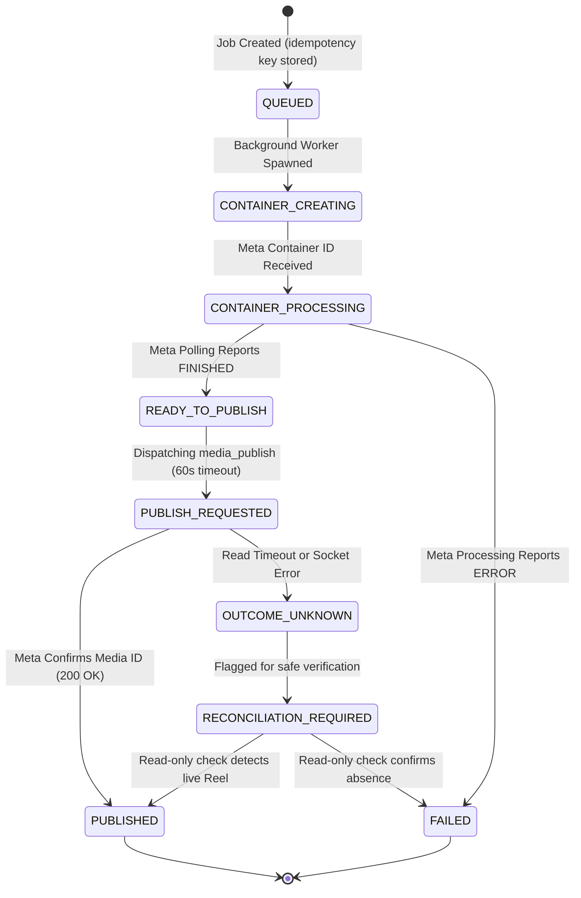
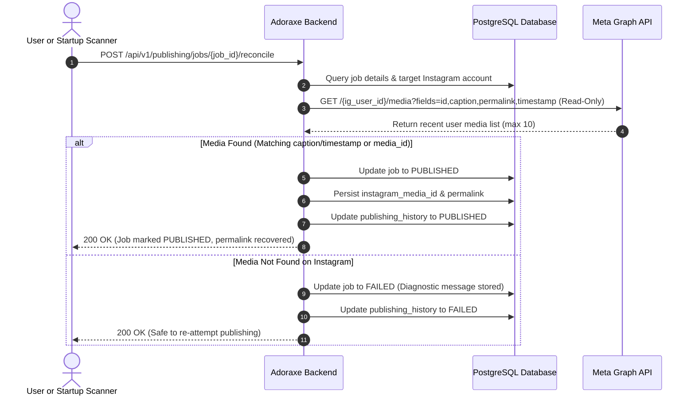

# Adoraxe Publishing Workflow & State Machine

This document provides an in-depth reference for the **persistent publishing job lifecycle**, **idempotency mechanisms**, **timeout handling**, and the **outcome reconciliation protocol** implemented in Adoraxe.

---

## 1. The Core Publishing Problem

Publishing media to social platforms via external REST APIs (such as the Meta Instagram Graph API) is inherently distributed and asynchronous. A standard Reel publication requires multiple consecutive network round-trips:

1. **Step A (Container Creation)**: Submitting the media URL and caption to Meta to allocate an Instagram media container (`creation_id`).
2. **Step B (Container Processing)**: Polling Meta's servers until the video is transcoded and reports status code `FINISHED`.
3. **Step C (Media Publish)**: Sending the final `POST /{ig_user_id}/media_publish` request to make the Reel publicly visible.

### The "Critical Window" & Why Blind Retries Cause Duplicate Posts
In traditional naive implementations, Step C is treated as a simple atomic request. If a network blip, client socket disconnect, or HTTP read timeout occurs during Step C, a standard HTTP client raises a `ReadTimeout` exception.

```
+-----------+                       +-------------------+
|  Adoraxe  |                       |  Meta Graph API   |
+-----+-----+                       +---------+---------+
      |                                       |
      |   POST /media_publish?creation_id     |
      +-------------------------------------->|  [Meta commits Reel to
      |                                       |   Instagram account]
      |   (Network timeout / socket drop)     |
      | - - - - - - - - - - - - - - - - - - - |
      X                                       |
```

If the application blindly catches the timeout and immediately executes a retry (or if the user clicks "Retry" because the UI showed "FAILED"), a **second live Reel is published to the creator's profile**.

To solve this, Adoraxe enforces a **persistent database-backed state machine**, **strict idempotency**, and a **safe read-only reconciliation protocol**.

---

## 2. The 8-Stage State Machine

Every publishing job persists its lifecycle in the `publishing_jobs` table across 8 distinct stages:



### Stage Definitions

| Stage | Status String | Description | Safe Next Action |
| :--- | :--- | :--- | :--- |
| **1. Queued** | `QUEUED` | Job created and persisted in PostgreSQL with unique `idempotency_key`. | Worker thread launched. |
| **2. Container Creating** | `CONTAINER_CREATING` | Submitting video Cloudinary URL and caption to `POST /{ig_user_id}/media`. | Await Meta response. |
| **3. Container Processing** | `CONTAINER_PROCESSING` | Meta is transcoding the 9:16 video container. Polling every 3-5 seconds. | Await `status_code: FINISHED`. |
| **4. Ready to Publish** | `READY_TO_PUBLISH` | Meta reports container transcoding complete. | Issue final publish call. |
| **5. Publish Requested** | `PUBLISH_REQUESTED` | `POST /{ig_user_id}/media_publish` dispatched with 60s timeout. | Await confirmation. |
| **6. Published** | `PUBLISHED` | Publication confirmed. `instagram_media_id` and `permalink` recorded. | Completed. Invariant locked. |
| **7. Outcome Unknown** | `OUTCOME_UNKNOWN` | Network dropped after publish call was sent. Outcome uncertain. | **NEVER auto-retry**. Reconcile. |
| **8. Reconciliation Required** | `RECONCILIATION_REQUIRED` | Awaiting read-only verification before allowing user action. | Trigger read-only reconciliation. |

---

## 3. Idempotency & Duplicate Prevention Architecture

Adoraxe prevents duplicate publications across three levels of the stack:

### 3.1 Deterministic Cryptographic Idempotency Key
Before any network communication, `JobRepository.create_publish_job()` computes an idempotency key:
$$\text{idempotency\_key} = \text{"pub\_"} + \text{instagram\_account\_id} + \text{"\_"} + \text{video\_id} + \text{"\_"} + \text{SHA256}(\text{caption})[0:16]$$

* A database unique constraint on `publishing_jobs.idempotency_key` guarantees that concurrent or duplicate requests cannot create two active records for the same operation.
* If a duplicate request arrives, the existing in-flight job is returned immediately with HTTP `200` or `409 Conflict`.

### 3.2 Pre-flight Publishing Guards
Before a job can be queued, `JobRepository.can_publish_video()` inspects:
1. Active jobs with status `QUEUED`, `CONTAINER_CREATING`, `CONTAINER_PROCESSING`, `READY_TO_PUBLISH`, or `PUBLISH_REQUESTED`.
2. Completed jobs with status `PUBLISHED` or `SIMULATED`.
3. Historical records in `publishing_history` with status `PUBLISHED`.

If any completed or active record exists, publishing is blocked:
```json
{
  "detail": "This video has already been published to this Instagram account on 2026-11-20 08:58:01 (Media ID: 18352444909254735). Duplicate publishing is prevented."
}
```

### 3.3 Monotonic Publishing History Rule
In distributed systems, a slow failure handler must never overwrite a successful publication. In `PublishingHistoryRepository.create_entry_failed()`:
```python
if existing.status in [PublishStatus.PUBLISHED.value, "PUBLISHED"]:
    logger.warning("Attempted to overwrite PUBLISHED status with FAILED. Monotonic protection enforced.")
    return existing
```

---

## 4. The Read-Only Outcome Reconciliation Protocol

When a job enters `OUTCOME_UNKNOWN` or `RECONCILIATION_REQUIRED`, the system provides a read-only reconciliation endpoint:
`POST /api/v1/publishing/jobs/{job_id}/reconcile`



### Why Reconciliation is Non-Destructive
* The reconciliation query uses an HTTP `GET` request (`GET /{ig_user_id}/media`).
* It **never calls** `POST /{ig_user_id}/media_publish`.
* It safely checks whether Meta created the Reel before modifying database records.

---

## 5. Startup Recovery & Client Disconnect Handling

### 5.1 Lifespan Startup Recovery
If the backend process crashes or restarts while a publishing job is in progress:
* FastAPI's `lifespan` handler executes `JobRepository.get_jobs_for_startup_recovery()`.
* Stale jobs in `PUBLISH_REQUESTED` are automatically transitioned to `RECONCILIATION_REQUIRED`.
* Interrupted jobs in `CONTAINER_PROCESSING` are evaluated or safely transitioned to `FAILED` with retry capability.
* No job is left hanging in an indeterminate state.

### 5.2 Client Disconnect & Tab Navigation
Publishing execution runs inside server-side `BackgroundTasks`. The client is completely decoupled:
* If a user navigates between `/queue` and `/history`, or closes their browser tab, the job continues executing to completion in the background.
* When the user returns, the frontend `publishingStore` queries `GET /api/v1/publishing/active` and restores the live progress, active stage, and caption seamlessly.


### 5.3 Stage-by-Stage Recovery Matrix (Render Free & Server Restarts)

When a server process terminates (e.g. during a deployment, server crash, or Render spin-down), the state persisted in PostgreSQL determines exact recovery behavior:

| Stage at Interruption | In-Flight Risk | Recovery Action on Startup (`lifespan`) | Duplicate Publish Risk |
| :--- | :--- | :--- | :--- |
| **`QUEUED`** | Worker task was killed before contacting Meta. | `pub.publish_reel()` claims job atomically and begins container creation. | **0%** (No Meta request was made) |
| **`CONTAINER_CREATING`** | Socket dropped while calling `POST /media`. | `pub.publish_reel()` re-attempts container creation. If a container was partially created on Meta, it is harmless (un-published containers expire automatically). | **0%** (`media_publish` was not called) |
| **`CONTAINER_PROCESSING`** | Server stopped while polling container status. | `pub.publish_reel()` **reuses the existing `instagram_container_id`** from PostgreSQL and resumes polling without creating a duplicate container. | **0%** (`media_publish` was not called) |
| **`READY_TO_PUBLISH`** | Container finished transcoding, but publish was not sent. | `pub.publish_reel()` issues `POST /media_publish` using the confirmed container. | **0%** (Single publish call) |
| **`PUBLISH_REQUESTED`** | **CRITICAL WINDOW**: Server died while `media_publish` was executing. | **NEVER re-attempts `media_publish`**. Automatically routes to `pub.reconcile_job()`. Queries Meta Graph API for recently posted Reels to verify if publication succeeded. | **0% (Protected by Read-Only Reconciliation)** |
| **`OUTCOME_UNKNOWN`** | Network timeout occurred after publish request was sent. | Routes to `pub.reconcile_job()`. If Reel exists on Instagram, status becomes `PUBLISHED`. If absent, becomes `FAILED`. | **0%** (Non-destructive `GET` query) |
| **`PUBLISHED`** | Process died after database recorded publication. | Terminal state. Monotonic history lock strictly blocks any failure callback from regressing status. | **0%** (Immutable success record) |

### 5.4 In-Process Worker Architecture vs. Separate Celery/Worker
* **Why In-Process Runner is Maintained**:
  Adoraxe utilizes FastAPI's `BackgroundTasks` backed by PostgreSQL state tracking and startup recovery. This architecture gives full crash durability while operating within **Render's Free Tier** (which permits 1 Web Service and excludes free background worker instances).
* **Limitations on Render Free Tier**:
  1. If the Web Service spins down due to 15 minutes of inactivity, background tasks in progress are halted until the next request wakes the server.
  2. Because frontend clients poll `/api/v1/publishing/active` during publishing, the service remains awake throughout the entire ~30-second publishing pipeline.
  3. If an unexpected container restart occurs, the `lifespan` hook ensures immediate recovery on next boot.
